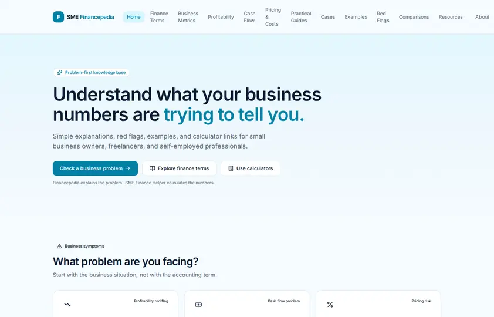
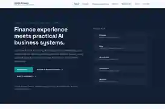

# Serghei Abramov — Project Portfolio

Practical tools and thoughtful business systems, created and maintained by [Serghei Abramov](https://sergheiabramov.com).

**Status:** portfolio prepared for review; GitHub Pages is not enabled. Download this repository and open `index.html` to preview. No installation or build is required.

## Selected live projects

### SME Finance Helper

Practical calculators, financial checks and business decision support for small businesses.

[Visit website](https://smefinancehelper.com) · [Public project overview](https://github.com/serabramov/sme-finance-helper)

Application source remains private and is not duplicated here. Aletheor Space is part of this application.

### SME Financepedia

Problem-first finance learning: plain-language terms, red flags and worked business examples.

[Visit website](https://smefinancepedia.com)

Financepedia explains the financial problem; SME Finance Helper helps calculate the numbers. Current source-repository destination is not verified; no replacement repository was created.

### Serghei Abramov

Professional profile, projects, articles and finance/AI business-systems work.

[Visit website](https://sergheiabramov.com)

The earlier static `serghei-site` repository is distinct from today's website. The current source-repository destination is not verified.

## Portfolio implementation

MyProjects holds portfolio presentation and public descriptions only. HTML/CSS, local public-page screenshots captured 13 November 2026, no trackers, external fonts, runtime dependencies or paid services. Full card layout is in `index.html`; GitHub limits README styling.

Existing websites, domains, analytics, source, deployments and integrations are unchanged. Unpublished prototypes and restricted corporate materials are not included. Publication requires separate owner approval.

## Creator and rights

**Serghei Abramov — creator and maintainer** · [GitHub](https://github.com/serabramov) · [Personal website](https://sergheiabramov.com)

AI-assisted development includes Lovable. Attribution does not assert sole authorship or ownership of third-party assets. Original portfolio content © 2026 Serghei Abramov; no open-source license is granted here. Third-party rights remain applicable. Public visibility and copyright notices do not prevent copying.

System previews use illustrative data, not client results or confirmed live integrations. Financial content is educational, not accounting, tax, legal, investment or financial advice.
